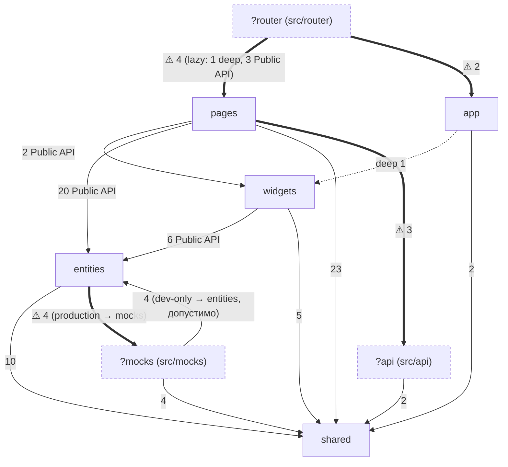
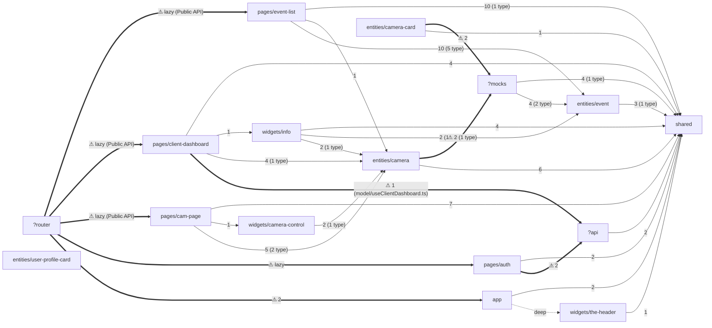

# Interaction Map

> Commit: `a630f2c` + незакоммиченные доработки страницы камеры, журнала событий и дашборда (рабочая копия) | Date: 2026-10-17
> Разделы 1–3, 4 (сценарии 5–8), 5–8 обновлены по `imports.json` после перезапуска сканера; остальное без изменений с `9e5be8f`.
> `UNVERIFIED`: связь `User` (`src/api/user/types.user.ts`) с доменом NVR (глоссарий); поведение `/archive`, страницы камеры, журнала событий и дашборда проверено только по коду, приложение не запускалось.
> Data regeneration: `node docs/ai/scripts/fsd-imports.mjs` → `docs/ai/reports/generated/{imports.json,slices.md}`
> Freshness: `git diff --name-status <map commit> HEAD -- src | rg '^(A|D|R)'`. Пустой вывод — карта актуальна. Пока доработка не закоммичена, хеш карты — `a630f2c`; после коммита заменить его на хеш коммита с доработкой.
> The map describes the ACTUAL state, including violations. Целевое состояние — `docs/ai/reports/02-fsd-audit.md` (таблица перемещений) и roadmap.

Метрики (из `imports.json`): 96 JS/TS-файлов, 16 узлов (11 слайсов FSD + `app`, `shared` + неизвестные слои `?api`, `?mocks`, `?router`), 32 ребра, 18 нарушений (16 `layer-upward`, 2 `non-public-api`: `MainLayout.tsx → widgets/the-header/TheHeader`, `routes.ts → pages/auth/Auth`), 0 циклов, 0 cross-slice. Все 16 `layer-upward` ложные: импорты *из* внеслойных `?api`, `?mocks`, `?router` (7 из них — `?mocks → entities/event`/`shared`, направление допустимо).

Сканер не видит корневые файлы `src/*.ts(x)`. Их связи (проверены вручную):
- `src/main.tsx` → `./app/global.css` (`:1`), `@/router/routes` (`:8`), `./mocks/browser` (динамически, только DEV, `:16`)
- `src/testSetup.ts` → `./mocks/server` (`:3`)
- `src/TestUtils.tsx` → только пакеты

## 1. Layer Graph

Сплошная стрелка — допустимо. Пунктир `deep` — импорт в обход Public API. Жирная `⚠` — проблема размещения: сканер её не флагует или флагует ложно (FSD-001/002/003). Числа — количество импортов.

Слой `features` пуст (намеренная заготовка — решение владельца) и в графе отсутствует.

## 2. Slice Graph

32 ребра ≤ 80 → одна диаграмма.

`entities/user-profile-card` и `entities/camera-card` — без потребителей (fan-in 0). Все стрелки `pages/* → entities|widgets` и `widgets/* → entities` идут через Public API (`index.ts`); deep остались только `app → widgets/the-header` и `?router → pages/auth`. `mocks → e_event` — моки берут типы и каталог событий из сущности (сканер помечает как `layer-upward`, это ложное срабатывание).

## 3. Slices

Public API (`index.ts`) есть у 7 из 11 слайсов: `pages/cam-page`, `pages/client-dashboard`, `pages/event-list`, `widgets/camera-control`, `widgets/info`, `entities/camera`, `entities/event`; в `shared` — у сегмента `ui`. У остальных «Public API» ниже — это экспортируемые символы файлов, которые импортируют извне.

### app
- Purpose: layout-маршруты и глобальные стили
- Public API: `app/layouts/empty/EmptyLayout.tsx` → `Component`, `app/layouts/main/MainLayout.tsx` → `Component`; `app/global.css` (импорт в `main.tsx`)
- Depends on: `shared` (`CalloutMessage` ×2), `widgets/the-header` (deep)
- Used in: `?router` (`routes.ts:2-3`)
- Data: —
- Notes: оба layout оборачивают `<Outlet/>` в Radix `Theme` (indigo/light) + `CalloutMessage`; `MainLayout` добавляет `TheHeader`

### pages/auth
- Purpose: вход по email/паролю + шаг 2FA
- Public API: `Auth.tsx` → `Component`; `model/useAuth.ts` → `useLoginMutation`, `useVerifyTwoFactorMutation` (внутренние)
- Depends on: `?api` (`login`, `verifyTwoFactor`, тип `AuthSuccess`), `shared` (`ApiErrorCode`, `isApiError`)
- Used in: `?router`
- Data: mutations `login` → `POST /api/auth/login` (`auth.js:153`), `verifyTwoFactor` → `POST /api/auth/login/2fa` (`auth.js:187`); пишет `accessToken`/`refreshToken` в `localStorage` (`Auth.tsx:34-35`)
- Routes: `/` (layout `EmptyLayout`)

### pages/client-dashboard
- Purpose: главная: живой просмотр всех камер (сетка) + «Обзор» (`widgets/info`)
- Public API: `index.ts` → `Component` (из `ui/ClientDashboard.tsx`); `model/useClientDashboard.ts` → `useClientDashboard` (не вызывается — заготовка, не удалять)
- Segments: `ui/` (`ClientDashboard`, `CameraGrid` — состояния загрузки/ошибки/пусто и сетка 1–2 колонки, `CameraGridCard` — `Card`: название-ссылка, `CameraStatusBadge`, кнопка «Открыть камеру», `CameraLiveView`), `model/` (legacy-хук)
- Depends on: `entities/camera` (Public API: `useCamerasQuery`, `CameraLiveView`, `CameraStatusBadge`), `widgets/info` (Public API), `shared` (`CONTENT_WITH_ASIDE_COLUMNS`, `ROUTES`, `formatCount`, `LoadError`), `?api` (только legacy-хук в `model/`)
- Used in: `?router` (`lazy: () => import('@/pages/client-dashboard')`)
- Data: `useCamerasQuery` → `GET /api/cameras` (один запрос на страницу, виджет и сетку — общий ключ); для каждой камеры `online` — свой `useCameraStreamQuery` и своя WHEP-сессия (`cam-1`, `cam-2`), `cam-3`/`cam-4` — заглушка без запроса `/stream`. Query `['sidebar']` → `GET /api/me/context` — в закомментированной заготовке владельца (`ui/ClientDashboard.tsx`), мока нет
- Routes: `/dashboard` (layout `MainLayout`); ссылки на камеры — `ROUTES.cameraDetail(id)`

### pages/cam-page
- Purpose: детальный просмотр камеры: заголовок со статусом, плеер, «Другие камеры», панель сведений
- Public API: `index.ts` → `Component` (из `ui/CamPage.tsx`)
- Segments: `ui/` (`CamPage`, `CameraView`, `OtherCameras`, `CamPage.module.scss`); плеер с заглушкой — `CameraLiveView` из `entities/camera`
- Depends on: `entities/camera` (Public API), `widgets/camera-control` (Public API), `shared` (`isApiError`, `ROUTES`, `CONTENT_WITH_ASIDE_COLUMNS`, `LoadError`, `InlineError`)
- Used in: `?router` (`lazy: () => import('@/pages/cam-page')`)
- Data: читает `:id` (`useParams`); `useCameraQuery(id)` → `GET /api/cameras/:id`; `useCameraStreamQuery` → `GET /api/cameras/:id/stream` только при `status === 'online'`; `useCamerasQuery` → `GET /api/cameras` (плитки других камер); плеер → WHEP
- States: загрузка (Skeleton), 404 → «Камера не найдена» (по `err.status`, не по `err.code` — DATA-001), прочая ошибка → Callout + «Повторить», `error`/`no_connection` → заглушка в плеере без запроса `/stream`
- Routes: `/:id/detail` (layout `MainLayout`); ссылки строятся через `ROUTES` (`shared/config/routes.ts`)

### pages/event-list
- Purpose: журнал событий регистратора: таблица тревог, предупреждений и детекций с фильтрами, сортировкой и пагинацией
- Public API: `index.ts` → `Component` (из `ui/EventList.tsx`)
- Segments: `ui/` (`EventList`, `EventFilters`, `EventTypeFilter`, `EventTable`, `EventListFooter` + 2 `*.module.scss`), `model/` (`eventListParams.ts` — разбор/сериализация URL, значения по умолчанию, `getNextSort`, `hasActiveFilters`; `useEventListParams.ts` — хук над `useSearchParams`)
- Depends on: `entities/event` (Public API: запрос, каталог, бейдж, подпись типа), `entities/camera` (`useCamerasQuery` для фильтра источника), `shared` (`ui`: `Pagination`, `SearchField`, `SortableHeaderCell`; `lib`: `isOneOf`, `formatCount`; `config/routes`; `components/callout` — `useCalloutMessage`)
- Used in: `?router` (`lazy: () => import('@/pages/event-list')`)
- Data: `useEventsQuery(params)` → `GET /api/events` (`keepPreviousData`); `useCamerasQuery` → `GET /api/cameras`. Состояние — в URL: `category`, `type` (повторяются), `source`, `period`, `q`, `sort`, `order`, `size`, `page`; значения по умолчанию не пишутся (`period=7d`, `sort=occurredAt`, `order=desc`, `size=25`, `page=1`)
- States: первая загрузка — skeleton-строки; смена выборки — таблица прошлой выборки с прозрачностью (`isPlaceholderData`); ошибка без данных — Callout + «Повторить»; ошибка фонового обновления — toast `useCalloutMessage`; пусто — «Событий не найдено» (+ «Сбросить фильтры»); страница за пределами выборки — замена на последнюю без записи в истории
- Routes: `/events` (layout `MainLayout`); ссылка «Источник» → `ROUTES.cameraDetail(cameraId)`

### widgets/the-header
- Purpose: шапка: статус устройства, навигация по разделам (SegmentedControl), кнопка настроек
- Public API: `TheHeader.tsx` → `TheHeader`
- Depends on: `shared` (`useMediaQuery`) · Used in: `app` (`MainLayout`)
- Data: — · Navigation: `dashboard`, `events`, `archive` (`TheHeader.tsx:8-12`); маршрута `/archive` нет

### widgets/info
- Purpose: «Обзор» — самодостаточная боковая панель: «Камеры в сети N из M» + разбивка по статусам; «События за сутки» — счётчики по категориям и 10 последних событий со ссылкой «Весь журнал»
- Public API: `index.ts` → `InfoBlock()` (без props; из `ui/InfoBlock.tsx`)
- Segments: `ui/` (`InfoBlock`, `CameraSummary`, `RecentEvents` + 2 `*.module.scss`)
- Depends on: `entities/camera` (`useCamerasQuery`, `CAMERA_STATUSES`, `CameraStatusBadge`), `entities/event` (`useEventsQuery`, `EVENT_CATEGORIES`, `EventCategoryBadge`, `EventTypeLabel`, `formatEventTime`, `DEVICE_SOURCE_LABEL`), `shared` (`ROUTES.events`, `formatRelativeTime`, `InlineError`)
- Used in: `pages/client-dashboard` (переиспользование планируется — решение владельца)
- Data: `useCamerasQuery` → `GET /api/cameras`; `useEventsQuery(RECENT_EVENTS_PARAMS)` → `GET /api/events?period=24h&pageSize=10&sort=occurredAt&order=desc` — одна выборка даёт и список, и `categoryCounts`

### widgets/camera-control
- Purpose: боковая панель камеры «Сведения»: статус и время последней активности, Callout для `error`/`no_connection`, технические параметры (`CameraDetailsList`). Действия с видео — в тулбаре плеера, не здесь
- Public API: `index.ts` → `CameraControls({camera})` (из `ui/CameraControls.tsx`)
- Depends on: `entities/camera` (Public API) · Used in: `pages/cam-page` · Data: — (получает `Camera` через props; переиспользование планируется — решение владельца)

### entities/camera
- Purpose: сущность «камера»: запросы, отображение статуса, плеер, сведения, плитка
- Public API: `index.ts` → `cameraKeys`, `useCamerasQuery`, `useCameraQuery`, `useCameraStreamQuery`, `formatLastSeen`, `CAMERA_STATUSES`, типы `Camera`/`CameraStatus`/`StreamInfo`, `CameraDetailsList`, `CameraLiveView`, `CameraPlayer`, `CameraStatusBadge`, `CameraStatusIcon`, `CameraTile`, `StreamPlaceholder`
- Segments: `api/` (`cameraApi.ts` — функции `apiFetch`; `cameraQueries.ts` — ключи и хуки), `model/` (`types.ts` — реэкспорт типов из моков, `status.ts` — `CAMERA_STATUSES`, `CAMERA_STATUS_META`), `lib/format.ts`, `ui/` (`CameraLiveView` = `useCameraStreamQuery` + `CameraPlayer` + `StreamPlaceholder`: «живое видео конкретной камеры» для страницы камеры и сетки дашборда)
- Depends on: `shared` (`apiFetch`, `retryUnlessClientError`, `captureVideoFrame`, `downloadBlob`, `useFullscreen`, `formatRelativeTime`), `?mocks` (legacy, выбор владельца: `model/types.ts` реэкспортирует типы из `mocks/data/nvrtypes.ts`, `ui/CameraPlayer.tsx` использует `useWebRtcPlayer` из `mocks/handlers/webrtc.ts`)
- Used in: `pages/cam-page`, `pages/client-dashboard`, `pages/event-list` (только `useCamerasQuery` для фильтра источника), `widgets/camera-control`, `widgets/info` (fan-in 5)
- Data: 3 query-хука (`references/data-layer.md`); `CameraPlayer` → WHEP по `stream.whepUrl`, переподключение — пересоздание поверхности плеера по `key`; `CameraTile` без живого видео (не открывает WHEP-сессию)
- Notes: `entities/camera-card` не может импортировать этот слайс (cross-slice) — объединение по M-2

### entities/camera-card
- Purpose: прежняя карточка камеры дашборда с WebRTC-видео; кнопка «Открыть» → `/cam-1/detail` (`ROUTES.cameraDetail`). **Не используется** с рефакторинга дашборда 2026-10-17 (его место заняли `CameraGridCard` + `CameraLiveView`); удаление или слияние с `entities/camera` — решение владельца (Q11 в `audit-plan.md`)
- Public API: `CameraCard.tsx` → `CameraCard({className?, camData?, children?})` (без `index.ts`)
- Depends on: `?mocks` (`useWebRtcPlayer` из `mocks/handlers/webrtc.ts`, тип `StreamInfo` из `mocks/data/nvrtypes.ts`), `shared` (`ROUTES`)
- Used in: — (fan-in 0)
- Data: захардкоженный `StreamInfo` для `cam-1` (`CameraCard.tsx:24-33`) → `POST /api/webrtc/cam-1/whep` (`nvr.ts:80`), при размонтировании `DELETE …/whep/:session` (`nvr.ts:106`)

### entities/event
- Purpose: сущность «событие журнала» (`NvrEvent`): каталог категорий и типов, запрос журнала, бейдж категории и подпись типа
- Public API: `index.ts` → `eventKeys`, `useEventsQuery`, `formatEventTime`; константы `DEVICE_SOURCE`, `EVENT_CATEGORIES`, `EVENT_PERIODS`, `EVENT_SORT_FIELDS`, `EVENT_TYPES`; метаданные `DEVICE_SOURCE_LABEL`, `EVENT_CATEGORY_META`, `EVENT_PERIOD_META`, `EVENT_TYPE_META`, `getEventTypesByCategory`; типы `EventCategory`, `EventPeriod`, `EventSortField`, `EventType`, `EventListParams`, `EventListResponse`, `NvrEvent`; `EventCategoryBadge`, `EventTypeLabel`
- Segments: `model/` (`catalog.ts` — массивы `as const` и выведенные из них типы; `meta.ts` — подписи, цвета, ранги, длительности периодов; `types.ts` — интерфейсы), `api/` (`eventApi.ts` — `getEvents`: период → `from` в момент запроса; `eventQueries.ts` — ключи и хук), `lib/format.ts`, `ui/`
- Depends on: `shared` (`apiFetch`, `retryUnlessClientError`, `PaginatedResponse`/`SortOrder`). От `?mocks` **не зависит**: типы определены в сущности, моки импортируют их отсюда
- Used in: `pages/event-list`, `widgets/info`; `?mocks` (`data/events.ts`, `handlers/events.ts`)
- Data: 1 query-хук (`references/data-layer.md`)
- Notes: 3 категории (`alarm` «Тревога» red, `warning` «Предупреждение» amber, `detection` «Детекция» blue) и 13 типов; категория типа фиксирована (`EVENT_TYPE_META[type].category`)

### entities/user-profile-card
- Purpose: карточка пользователя (аватар, имя, роль)
- Public API: `UserProfileCard.tsx` → `UserProfileCard({userName, userRole, imgSrc})`
- Depends on: — · Used in: — (заготовка, не удалять — решение владельца) · Data: —

### shared
- Purpose: HTTP-клиент, коды ошибок API, toast-провайдер, пути маршрутов, UI-кит, хуки/утилиты
- Public API: `ui/index.ts` → `InlineError`, `LoadError`, `Pagination`, `SearchField`, `SortableHeaderCell` (единственный сегмент с `index`); `config/layout.ts` → `CONTENT_WITH_ASIDE_COLUMNS` (основная колонка + панель 320 px; страница камеры и дашборд); `lib/formatRelativeTime.ts` → `formatRelativeTime`; без `index`: `api/http.ts` → `apiFetch`, `ApiError`, `createApiError`, `isApiError`; `api/authErrorCodes.ts` → `ApiErrorCode`, `ApiErrorCodeType`; `api/pagination.ts` → `PaginatedResponse<T>`, `SortOrder`; `api/retry.ts` → `retryUnlessClientError`; `components/callout/CalloutMessage.tsx` → `CalloutMessage`, `useCalloutMessage`; `components/callout/types.ts` → `Message`, `MessageType`, `ProviderProps`, `ShowToast`; `config/routes.ts` → `ROUTES` (`cameraDetail(id)`, `dashboard`, `events`); `lib/useFullscreen.ts`, `lib/captureVideoFrame.ts`, `lib/downloadBlob.ts`, `lib/isOneOf.ts` (сужение строки до `as const`-списка), `lib/pluralize.ts` (`pluralize`, `formatCount`); `utils/useMediaQuery.ts` → `useMediaQuery`; `utils/auth.ts` → `makeToken`
- Depends on: только пакеты (`react`, `@radix-ui/*`)
- Used in: `app`, `pages/auth`, `pages/cam-page`, `pages/client-dashboard`, `pages/event-list`, `widgets/info`, `widgets/the-header`, `entities/camera`, `entities/camera-card`, `entities/event`, `?api`, `?mocks` (fan-in 12, максимум)
- Notes: сегменты `ui/`, `config/`, `lib/` — целевые имена; `components/`, `utils/` — legacy (QW-9). `ui/*` — без доменных знаний: `Pagination` (постоянно 7 номеров, `getPaginationItems.ts`), `SearchField` (задержка 300 мс, Escape очищает), `SortableHeaderCell<T>` (кнопка в заголовке Radix `Table` + `aria-sort`), `LoadError` (красный Callout + «Повторить» для основного содержимого), `InlineError` (строка + маленькая «Повторить» для второстепенного блока)

### ?router (`src/router`)
- Purpose: конфигурация `createBrowserRouter`
- Public API: `routes.ts` → `router` (импорт в `main.tsx:8`)
- Depends on: `app` (2 layout), все 4 `pages/*` через `lazy: () => import(...)` (fan-out 5, максимум); `pages/cam-page`, `pages/client-dashboard`, `pages/event-list` — через Public API, `pages/auth` — deep
- Notes: `README.md` — карта эндпоинтов `/api/nvr…`, к роутингу не относится. Целевое место — `app/router` (согласовано)

### ?api (`src/api`)
- Purpose: API-функции и типы auth/user
- Public API: `auth/auth.ts` → `login`, `verifyTwoFactor`; `auth/auth.types.ts` → `AuthSuccess`, `LoginPayload`, `LoginResponse`, `TwoFactorRequired`; `user/user.ts` → `getDashboard`; `user/types.user.ts` → `User` (не используется)
- Depends on: `shared/api/http` · Used in: `pages/auth`, `pages/client-dashboard`
- Notes: целевое место — `entities/session`, `entities/user` (согласовано)

### ?mocks (`src/mocks`)
- Purpose: MSW (dev/test) + **production-хук плеера** `handlers/webrtc.ts` и доменные типы `data/nvrtypes.ts`
- Public API: `browser.js` → `worker`; `server.js` → `server`; `handlers/index.js` → `authHandlers`, `resetMockState`, `nvrHandlers`, `eventHandlers`; `handlers/webrtc.ts` → `useWebRtcPlayer`, `PlayerState`; `data/nvrtypes.ts` → `Camera`, `CameraStatus`, `PoePort`, `NvrInfo`, `StreamInfo`, `IceServer`, `ApiErrorBody`; `data/events.ts` → `events` (фикстура журнала)
- Depends on: `shared` (`makeToken`, `ApiErrorCode`, `SortOrder`, `isOneOf`), `entities/event` (типы и каталог — допустимое направление mocks → entities)
- Used in: `entities/camera-card`, `entities/camera` (по графу, legacy); `main.tsx`, `testSetup.ts` (вне графа)
- Data: все 14 хендлеров — `references/data-layer.md`

## 4. End-to-End Scenario Chains

| # | Сценарий | Цепочка |
|---|---|---|
| 1 | Старт приложения | `index.html:35` → `src/main.tsx` → (DEV) `mocks/browser.js` `worker.start` → `StrictMode` > `QueryClientProvider` > `RouterProvider(router)` (`?router/routes.ts`) |
| 2 | Вход без 2FA | `/` → `app/layouts/empty` → `pages/auth` `Component` → `useLoginMutation` (`pages/auth/model/useAuth.ts:4`) → `login` (`?api/auth/auth.ts:4`) → `apiFetch` (`shared/api/http.ts:26`) → `POST /api/auth/login` (`mocks/handlers/auth.js:153`, `db.accounts`) → 200 → `localStorage` → `navigate('/dashboard')` |
| 3 | Вход с 2FA | как 2 → 200 `{requiresTwoFactor, tempToken}` → шаг `2fa` (`Auth.tsx:164`) → `useVerifyTwoFactorMutation` → `verifyTwoFactor` (`auth.ts:11`) → `POST /api/auth/login/2fa` (`auth.js:187`, код `123456`) → как 2 |
| 4 | Ошибки входа | `POST /api/auth/login` → 422/401/423/429/500 (`auth.js:132-184`) → `apiFetch` → `createApiError` (`http.ts:34`) → `onError` → switch по `ApiErrorCode` (`Auth.tsx:59-88`) → текст в форме |
| 5 | Дашборд камер | `/dashboard` → `app/layouts/main` (`widgets/the-header` + `shared` `CalloutMessage`) → `pages/client-dashboard` `Component` → `useCamerasQuery` → `GET /api/cameras` (`nvr.ts:45`, один запрос на страницу, `CameraGrid` и `widgets/info`) → `CameraGrid` → `CameraGridCard` на каждую камеру → `CameraLiveView` (`entities/camera`) → для `online` `useCameraStreamQuery` → `GET /api/cameras/:id/stream` (`nvr.ts:60`) → `CameraPlayer` → `useWebRtcPlayer` (`?mocks/handlers/webrtc.ts:60`) → `POST /api/webrtc/:id/whep` (`nvr.ts:80`) → `createMockWhepSession` (`mockWhep.ts:58`) → canvas-видео с названием камеры; `cam-3`/`cam-4` → `StreamPlaceholder` без запроса. Параллельно `widgets/info`: `CameraSummary` (тот же `useCamerasQuery`) и `RecentEvents` → `useEventsQuery` → `GET /api/events?period=24h&pageSize=10` (`mocks/handlers/events.ts`) |
| 6 | Детальный просмотр | `CameraGridCard` (название или «Открыть камеру») → `ROUTES.cameraDetail(id)` → `/cam-N/detail` → `pages/cam-page` `Component` → `useParams().id` → `useCameraQuery` (`entities/camera/api/cameraQueries.ts`, placeholder из кеша списка) → `GET /api/cameras/:id` (`nvr.ts:50`) → при `online` `useCameraStreamQuery` → `GET /api/cameras/:id/stream` (`nvr.ts:60`) → `CameraLiveView` → `CameraPlayer` → `useWebRtcPlayer` (`?mocks`) → `POST /api/webrtc/:id/whep` (`nvr.ts:80`); параллельно `useCamerasQuery` → `GET /api/cameras` (`nvr.ts:45`) → `CameraTile` → переход на другую камеру (`key` плеера меняется → `DELETE …/whep/:session`, `nvr.ts:106`, затем новая сессия); `widgets/camera-control` получает `Camera` через props. Неизвестный id → 404 → «Камера не найдена» |
| 7 | Навигация в шапке | `widgets/the-header` `SegmentedControl` → `navigate('/' + value)` (`TheHeader.tsx:21`) → `/dashboard`, `/events` (`pages/event-list`, сценарий 8), `/archive` (маршрута нет → стандартная страница ошибки react-router) |
| 8 | Журнал событий | `/events?…` → `app/layouts/main` → `pages/event-list` `Component` → `useEventListParams` (`model/useEventListParams.ts`: `useSearchParams` → `parseEventListParams`) → `useEventsQuery(params)` (`entities/event/api/eventQueries.ts`, `keepPreviousData`) → `getEvents` (`eventApi.ts`: период → `from`) → `apiFetch` → `GET /api/events` (`mocks/handlers/events.ts`: валидация → фильтры → `categoryCounts` → категория → сортировка → срез страницы; фикстура `mocks/data/events.ts`) → `EventFilters` (счётчики категорий, типы, источник через `useCamerasQuery` → `GET /api/cameras`), `EventTable`, `EventListFooter`. Изменение фильтра/сортировки/страницы → `setSearchParams` (фильтры и сортировка → `page=1`; поиск — `replace`) → новый ключ → запрос. Ссылка в колонке «Источник» → `ROUTES.cameraDetail(id)` → сценарий 6. Ошибка фонового обновления → toast `useCalloutMessage`; `q=error500` → 500 |

Эндпоинты, к которым нет ни одной цепочки: `/api/nvr`, `/api/nvr/ports`, `/api/auth/{refresh,me,logout}`.

## 5. Cross-Cutting Mechanisms

| Механизм | Где | Факт |
|---|---|---|
| Bootstrap и провайдеры | `src/main.tsx:10,29-33` | `QueryClient` (дефолты), `QueryClientProvider`, `ReactQueryDevtools`, `RouterProvider`; не в слое `app` |
| Моки | `src/main.tsx:12-24`, `src/testSetup.ts` | worker только в DEV, рендер после старта; node-server в тестах |
| Роутинг | `src/router/routes.ts` | 2 layout-маршрута без `path`, 4 lazy-страницы; страница экспортирует `Component`; `errorElement` нет |
| Тема | `app/layouts/{empty,main}/*Layout.tsx:8-9` | Radix `Theme accentColor='indigo' appearance='light'` дважды; `@radix-ui/themes/styles.css` в `main.tsx:2`; `index.html:4` — Tailwind-классы `dark:` на `<html>` |
| Стили | `vite.config.ts:12-18` | `@/assets/scss/variables.scss` автоматически подключается в каждый SCSS; CSS Modules; Tailwind-плагин |
| Уведомления | `shared/components/callout/CalloutMessage.tsx` | Context-провайдер toast в каждом layout; `useCalloutMessage` — 1 потребитель (`pages/event-list/ui/EventList.tsx`, ошибка фонового обновления) |
| Глобальное состояние | — | store нет; серверное состояние — TanStack Query (5 query-хуков: `['sidebar']`, 3 по камерам в `entities/camera`, 1 журнал в `entities/event`); одинаковые ключи из разных компонентов (`useCamerasQuery` на дашборде ×3) — один запрос |
| Ошибки загрузки в UI | `shared/ui` `LoadError`, `InlineError` | основное содержимое — `LoadError` (страница камеры, журнал, сетка дашборда); второстепенный блок — `InlineError` («Другие камеры», блоки «Обзора») |
| Состояние в URL | `pages/event-list/model/` | фильтры, сортировка и страница журнала — query-параметры (`useSearchParams`); значения по умолчанию не пишутся; образец для других списков |
| Серверная пагинация | `shared/api/pagination.ts` | ответ `PaginatedResponse<T>` = `{items, page, pageSize, total}`, `page` с 1; UI — `shared/ui` `Pagination` |
| Ошибки | `shared/api/http.ts` | `ApiError` + `isApiError`; ErrorBoundary/`errorElement` нет |
| Авторизация | `pages/auth/Auth.tsx:34-35` | токены в `localStorage`; заголовок `Authorization` не отправляется; защиты маршрутов нет (`/dashboard` доступен без входа) |
| i18n | — | нет; UI-строки на русском в JSX (`noJsxLiterals` off) |
| Dev-сервер | `vite.config.ts:26-31` | HTTPS с `certs/*.pem` (git-ignored) |

## 6. Hotspots

| Узел | Метрика / факт | Почему важно |
|---|---|---|
| `shared` | fan-in 12 (максимум) | изменения расходятся по всем слоям и мокам |
| `?router` | fan-out 5 (максимум) | пути маршрутов захардкожены ещё в 2 слайсах (раздел 7, п. 5) |
| `entities/camera` | fan-in 5 (максимум среди слайсов), fan-out 2; зависит от `?mocks` (legacy, выбор владельца) | через него страница камеры, дашборд, журнал и оба виджета получают камеры, плеер и типы; при M-2 меняется только этот слайс |
| `entities/camera-card` | fan-in 0; зависит от `?mocks` | не используется с рефакторинга дашборда; ждёт решения владельца (Q11). MAP-2 (4 WHEP-сессии к `cam-1`) снято: на дашборде своя сессия у каждой камеры в сети |
| `pages/client-dashboard` | fan-out 4 (максимум среди слайсов FSD) | связывает `entities/camera`, `widgets/info`, `shared` и legacy `?api` (заготовка `model/useClientDashboard.ts`) |
| `pages/cam-page`, `pages/event-list`, `widgets/info` | fan-out 3 | `cam-page` — `entities/camera`, `widgets/camera-control`, `shared`; `event-list` — `entities/event`, `entities/camera`, `shared`; `widgets/info` — `entities/camera`, `entities/event`, `shared` |
| `entities/event` | fan-in 3 (`pages/event-list`, `widgets/info`, `?mocks`) | контракт `GET /api/events` общий для UI и мока: правка `model/*` меняет и фикстуру, и хендлер |
| `?mocks` | содержит production-код (`handlers/webrtc.ts`, `data/nvrtypes.ts`) | удаление/отключение моков сломает сборку |
| `entities/user-profile-card` | fan-in 0, fan-out 0 | изолирован (заготовка) |
| Public API | 7 из 11 слайсов + сегмент `shared/ui`; без `index` — `pages/auth`, `widgets/the-header`, `entities/camera-card`, `entities/user-profile-card` | deep остались 2 (`non-public-api`): `MainLayout.tsx → widgets/the-header/TheHeader`, `routes.ts → pages/auth/Auth` |
| Циклы | 0 | — |

## 7. If changing X, check Y

1. **`shared/api/http.ts`** (`apiFetch`, `ApiError`) → `?api/auth/auth.ts`, `?api/user/user.ts`, `entities/camera/api/cameraApi.ts`, `entities/event/api/eventApi.ts`, `shared/api/retry.ts` → `pages/auth` (обработка ошибок `Auth.tsx:53-139`), `pages/client-dashboard`, `pages/cam-page`, `pages/event-list`, `widgets/info`. Сверить формат ошибок моков: `{error}` (auth, events) и `{code}` (nvr).
2. **`shared/api/authErrorCodes.ts`** → switch в `Auth.tsx:59-88` и `http.ts:36`; `mocks/handlers/events.ts` (`VALIDATION_ERROR`, `INTERNAL_ERROR`). Строки кодов должны совпадать с `error` в `mocks/handlers/auth.js`.
3. **`shared/components/callout/*`** → оба layout (`app/layouts/*`, оборачивает `<Outlet/>` — поломка затронет все маршруты) и `pages/event-list/ui/EventList.tsx` (`useCalloutMessage`). `widgets/info` от него больше не зависит (FSD-011: дублирование иконок и цветов callout в виджете снято).
4. **`shared/utils/useMediaQuery.ts`** → `widgets/the-header` → `MainLayout` → маршруты `/dashboard`, `/:id/detail`, `/events`.
5. **Пути маршрутов** (`router/routes.ts`) → дублируются в `shared/config/routes.ts` (`ROUTES`: `cameraDetail(id)`, `dashboard`, `events`; потребители — `pages/cam-page`, `pages/client-dashboard`, `pages/event-list`, `widgets/info`, `entities/camera-card/CameraCard.tsx:38`) и захардкожены в `pages/auth/Auth.tsx:36` (`/dashboard`), `widgets/the-header/TheHeader.tsx:9-11` (`dashboard`, `events`, `archive`). Меняя путь в роутере, править и `ROUTES`.
6. **Экспорт страницы/layout** должен остаться `Component`: его ожидают `routes.ts:2-3` и `lazy` (`:10,19,23,27`); у `pages/cam-page`, `pages/client-dashboard` и `pages/event-list` — через `index.ts`.
7. **`entities/camera-card`** → потребителей нет (Q11). Если вернуть его в использование: `currCamId` (`:17`) должен совпадать с id захардкоженного потока, иначе «Открыть» ведёт на «Камера не найдена».
8. **`mocks/handlers/webrtc.ts` или `mocks/data/nvrtypes.ts`** → production `entities/camera-card` и `entities/camera` (`model/types.ts`, `ui/CameraPlayer.tsx`), а также `mocks/handlers/nvr.ts` и `mocks/data/nvr.ts`. Правка «мока» меняет UI.
9. **Новый массив MSW-хендлеров** → добавить в `mocks/handlers/index.js`, `mocks/browser.js` и `mocks/server.js` (они перечисляют массивы явно).
10. **`?api/auth/auth.types.ts`** → `pages/auth/Auth.tsx:8` (`AuthSuccess`), `model/useAuth.ts`; форма ответа задаётся `mocks/handlers/auth.js:118-128,208-218` (`sanitize` удаляет `password`).
11. **`shared/utils/auth.ts` (`makeToken`)** → только `mocks/handlers/auth.js`; префикс `rt_` проверяет refresh-хендлер (`auth.js:225`).
12. **`src/assets/scss/variables.scss`** (имя/путь) → `vite.config.ts:15` подключает его во все 17 остальных SCSS-файлов (`find src -name '*.scss' ! -name variables.scss`); переименование сломает сборку стилей.
13. **Переименование/перенос слоёв** → группы `organizeImports` в `biome.json:14-24` завязаны на `@/app … @/shared`.
14. **Перенос файлов из `src/mocks`** (FSD-001) → `vite.config.ts:37` (coverage exclude), `src/main.tsx:16`, `src/testSetup.ts:3`.
15. **Любой новый `index.ts`** → `performance/noBarrelFile` отключён override в `biome.json` только для `src/{pages,widgets,features,entities}/*/index.ts` и `src/shared/*/index.ts`; реэкспорт из файла с другим именем или глубже по дереву `biome ci` уронит.
16. **`entities/camera`** (`api/cameraQueries.ts`, `ui/*`) → `pages/cam-page` (все 3 компонента `ui/`), `pages/client-dashboard` (`CameraGrid`, `CameraGridCard`), `pages/event-list` (`EventFilters`), `widgets/camera-control`, `widgets/info` (`CameraSummary`). Форма ответа задаётся `mocks/handlers/nvr.ts:45-78`; статусы `error`/`no_connection` приходят в `GET /api/cameras/:id` с кодом 200, а `/stream` для них отвечает 504/404 — поэтому `/stream` запрашивается только для `online`.
17. **Ключи `cameraKeys`** (`['cameras', …]`) → инвалидация по префиксу `cameraKeys.all`; `useCameraQuery` берёт placeholder из `cameraKeys.list()`, поэтому формат элементов списка и детальной карточки должен совпадать (`Camera`).
18. **Каталог событий** (`entities/event/model/catalog.ts`, `meta.ts`) → UI (`EventTypeFilter`, `EventFilters`, `EventTable`, `EventTypeLabel` — иконка на каждый тип), разбор URL (`pages/event-list/model/eventListParams.ts`), мок (`mocks/data/events.ts` — веса и тексты на каждый тип, `mocks/handlers/events.ts` — валидация и сортировка по `rank`/`label`). Новый тип события: добавить в `EVENT_TYPES`, `EVENT_TYPE_META`, `TYPE_ICONS` (`ui/EventTypeLabel.tsx`), `TYPE_WEIGHTS` и `MESSAGE_BUILDERS` (`mocks/data/events.ts`); `Record<EventType, …>` в трёх из них заставит `tsc` напомнить.
19. **Контракт `GET /api/events`** (`EventListParams`, `EventListResponse`, `getEvents`) → `mocks/handlers/events.ts` (`parseQuery`: имена параметров `page`, `pageSize`, `sort`, `order`, `category`, `type`, `source`, `from`, `q`; допустимые `pageSize` — 10/25/50/100, совпадают с `PAGE_SIZE_OPTIONS` страницы и `RECENT_EVENTS_PARAMS.pageSize = 10` в `widgets/info/ui/RecentEvents.tsx`). Несовпадение → 400 `VALIDATION_ERROR`.
20. **Имена query-параметров страницы журнала** (`URL_KEYS` в `pages/event-list/model/eventListParams.ts`) → сохранённые пользователями ссылки `/events?…`; переименование ломает их молча (неизвестный параметр игнорируется).
21. **Фикстура камер** (`mocks/data/nvr.ts`: `id`, `name`, `lastSeen`, `status`) → `mocks/data/events.ts`: события камеры генерируются только до её `lastSeen`, для камеры в `error` добавляется `video_loss` в момент `lastSeen` с `camera.error.message`.
22. **`CameraLiveView` / `StreamPlaceholder` / `CameraPlayer`** (`entities/camera/ui`) → страница камеры (`CameraView`) и каждая ячейка сетки дашборда (`CameraGridCard`). Любое изменение плеера (тулбар, состояния, размеры заглушки) видно в обоих местах; на дашборде ячейки ~16:9 шириной около половины колонки — проверять, что текст заглушки помещается. Потребитель обязан ставить `key={camera.id}`, если камера в том же месте дерева может смениться.
23. **`CONTENT_WITH_ASIDE_COLUMNS`** (`shared/config/layout.ts`) → `pages/cam-page` (`CamPage` — скелет, `CameraView`) и `pages/client-dashboard`; ширина 320 px совпадает у `widgets/camera-control` и `widgets/info`.

## 8. Glossary

| Термин | Значение | Где в коде |
|---|---|---|
| NVR («Устройство») | сетевой видеорегистратор: модель, прошивка, PoE-бюджет, диск | `mocks/data/nvr.ts` (`getNvrInfo`), `GET /api/nvr`; заголовок `TheHeader.tsx:46`; слайса нет |
| Камера | IP-камера на PoE-порту NVR; статусы `online` («В сети») / `error` («Ошибка») / `no_connection` («Не подключена») | `entities/camera` (`model/status.ts`), `entities/camera-card`; тип `Camera` (`mocks/data/nvrtypes.ts:8`, реэкспорт `entities/camera/model/types.ts`); `GET /api/cameras[/:id]` |
| PoE-порт | порт питания/данных NVR | тип `PoePort`, `GET /api/nvr/ports`; UI нет |
| Поток (WHEP/WebRTC) | параметры воспроизведения и сигналинг SDP | `StreamInfo`, `useWebRtcPlayer` (`mocks/handlers/webrtc.ts`), `mocks/handlers/mockWhep.ts`, `/api/cameras/:id/stream`, `/api/webrtc/:id/whep` |
| Сессия / вход | логин, 2FA (TOTP, `tempToken`), `accessToken`/`refreshToken` | `pages/auth`, `?api/auth`, `mocks/handlers/auth.js` |
| Аккаунт | пользователь с ролями `instructor` / `client` | `MockUser` (`?api/auth/auth.types.ts:5`), `mocks/data/accounts.json`, `entities/user-profile-card` |
| Контекст дашборда (`User`) | поля `sports`, `upcomingSessions`, `waitlisted`, `totalSpent`, `instructorsCount` | `?api/user/types.user.ts`; связь с доменом NVR — `UNVERIFIED` |
| События / Уведомления | запись журнала регистратора (`NvrEvent`): категория (`alarm` «Тревога», `warning` «Предупреждение», `detection` «Детекция»), тип (13 типов: вторжение, саботаж, потеря сигнала, питание, диск, PoE, связь, вход, движение, человек, транспорт, линия), источник — камера или само устройство (`cameraId: null`, фильтр `source=device`) | `entities/event`, `pages/event-list` («Журнал событий»), `GET /api/events`; `widgets/info` («События за сутки» на дашборде); пункт «Уведомления» в шапке |
| Обзор | боковая панель дашборда: камеры в сети и события за сутки | `widgets/info` |
| Живой просмотр | сетка видео всех камер на дашборде; у каждой камеры в сети своя WHEP-сессия | `pages/client-dashboard/ui/CameraGrid.tsx`, `entities/camera/ui/CameraLiveView.tsx` |
| Архив | раздел в навигации | `TheHeader.tsx:11`; маршрута нет |
| Управление / Сведения | боковая панель камеры (заголовок «Сведения»): статус, ошибка, параметры; действия с видео (переподключить, снимок, полный экран) — тулбар `CameraPlayer`. PTZ нет: в API и типе `Camera` нет PTZ-эндпоинтов и полей (`rg -i ptz src` → 0) | `widgets/camera-control`, `entities/camera/ui/CameraPlayer.tsx` |
