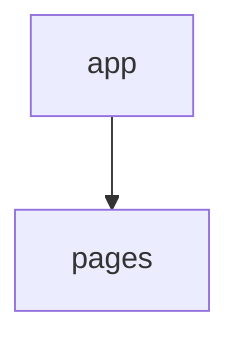

# Interaction Map

> TEMPLATE. To be filled in during phase 5 (`docs/ai/prompts/05-interaction-map.md`).
> Commit: `<not filled>` | Date: `<not filled>`
> Data regeneration: `node docs/ai/scripts/fsd-imports.mjs` → `docs/ai/reports/generated/`
> The map describes the ACTUAL state, including violations.

## 1. Layer Graph

<!-- FILL: edges with import counts; violations marked. -->

## 2. Slice Graph

<!-- FILL: single Mermaid diagram if ≤80 edges; otherwise, split by layer. -->

## 3. Slices

<!-- FILL: card for each slice.
### features/example
- Purpose: ...
- Public API: ...
- Depends on: ...
- Used in: ...
- Data: queries/mutations/handlers ...
- Routes: ... (for pages)
-->

## 4. End-to-End Scenario Chains

<!-- FILL: route → page → widgets → features → entities → API function → MSW handler; 5–8 main scenarios. -->

## 5. Cross-Cutting Mechanisms

<!-- FILL: providers in app, router, global state, i18n, theme, errors, authorization (with paths). -->

## 6. Hotspots

<!-- FILL: slices with high fan-in/fan-out, cycles, slices without a Public API. -->

## 7. If changing X, check Y

<!-- FILL: 8–15 rules derived from the graph. --> -->

## 8. Glossary

<!-- FILL: project domain terms and corresponding slices. -->