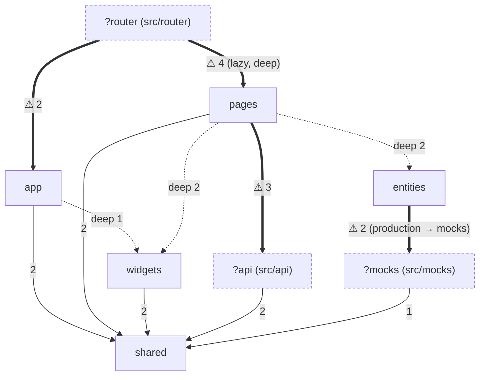
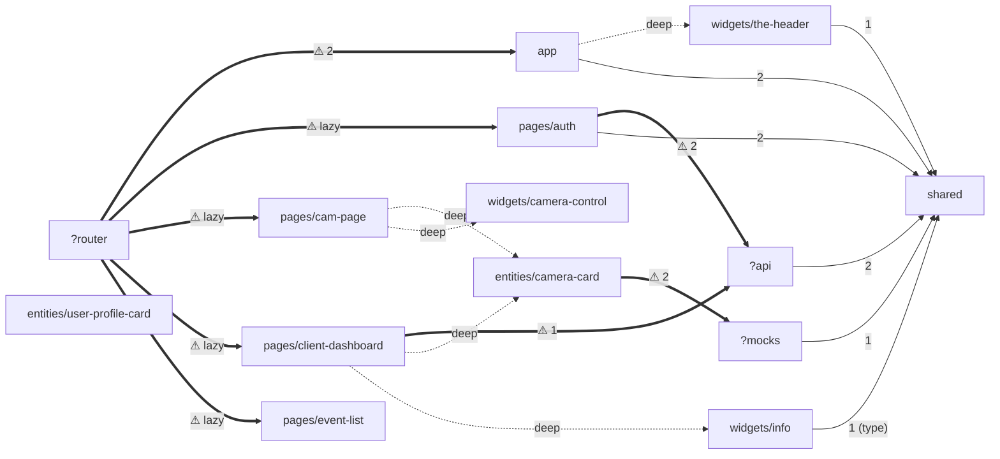

# Interaction Map

> Commit: `9e5be8f` (`src/` идентичен `a22ced1`) | Date: 2026-10-17
> `UNVERIFIED`: связь `User` (`src/api/user/types.user.ts`) с доменом NVR (глоссарий); поведение `/archive` проверено только по коду, приложение не запускалось.
> Data regeneration: `node docs/ai/scripts/fsd-imports.mjs` → `docs/ai/reports/generated/{imports.json,slices.md}`
> Freshness: `git diff --name-status 9e5be8f HEAD -- src | rg '^(A|D|R)'`. Пустой вывод — карта актуальна.
> The map describes the ACTUAL state, including violations. Целевое состояние — `docs/ai/reports/02-fsd-audit.md` (таблица перемещений) и roadmap.

Метрики (из `imports.json`): 38 JS/TS-файлов, 14 узлов (10 слайсов FSD + `app`, `shared` + неизвестные слои `?api`, `?mocks`, `?router`), 19 рёбер, 18 нарушений (9 `layer-upward`, 9 `non-public-api`), 0 циклов.

Сканер не видит корневые файлы `src/*.ts(x)`. Их связи (проверены вручную):
- `src/main.tsx` → `./app/global.css` (`:1`), `@/router/routes` (`:8`), `./mocks/browser` (динамически, только DEV, `:16`)
- `src/testSetup.ts` → `./mocks/server` (`:3`)
- `src/TestUtils.tsx` → только пакеты

## 1. Layer Graph

Сплошная стрелка — допустимо. Пунктир `deep` — импорт в обход Public API. Жирная `⚠` — проблема размещения: сканер её не флагует или флагует ложно (FSD-001/002/003). Числа — количество импортов.

Слой `features` пуст (намеренная заготовка — решение владельца) и в графе отсутствует.

## 2. Slice Graph

19 рёбер ≤ 80 → одна диаграмма.

`entities/user-profile-card` — изолированный узел (fan-in 0, fan-out 0).

## 3. Slices

Public API (`index`) нет ни у одного слайса. Поэтому «Public API» ниже — это экспортируемые символы файлов, которые импортируют извне.

### app
- Purpose: layout-маршруты и глобальные стили
- Public API: `app/layouts/empty/EmptyLayout.tsx` → `Component`, `app/layouts/main/MainLayout.tsx` → `Component`; `app/global.css` (импорт в `main.tsx`)
- Depends on: `shared` (`CalloutMessage` ×2), `widgets/the-header` (deep)
- Used in: `?router` (`routes.ts:2-3`)
- Data: —
- Notes: оба layout оборачивают `<Outlet/>` в Radix `Theme` (indigo/light) + `CalloutMessage`; `MainLayout` добавляет `TheHeader`

### pages/auth
- Purpose: вход по email/паролю + шаг 2FA
- Public API: `Auth.tsx` → `Component`; `model/useAuth.ts` → `useLoginMutation`, `useVerifyTwoFactorMutation` (внутренние)
- Depends on: `?api` (`login`, `verifyTwoFactor`, тип `AuthSuccess`), `shared` (`ApiErrorCode`, `isApiError`)
- Used in: `?router`
- Data: mutations `login` → `POST /api/auth/login` (`auth.js:153`), `verifyTwoFactor` → `POST /api/auth/login/2fa` (`auth.js:187`); пишет `accessToken`/`refreshToken` в `localStorage` (`Auth.tsx:34-35`)
- Routes: `/` (layout `EmptyLayout`)

### pages/client-dashboard
- Purpose: сетка камер + блок «Обзор»/события
- Public API: `ClientDashboard.tsx` → `Component`; `model/useClientDashboard.ts` → `useClientDashboard` (не вызывается — заготовка)
- Depends on: `entities/camera-card`, `widgets/info`, `?api` (`getDashboard` через хук)
- Used in: `?router`
- Data: query `['sidebar']` → `GET /api/me/context` (мока нет; хук закомментирован). Каждая из 4 `CameraCard` открывает WHEP-сессию
- Routes: `/dashboard` (layout `MainLayout`)

### pages/cam-page
- Purpose: детальный просмотр камеры
- Public API: `CamPage.tsx` → `Component`
- Depends on: `entities/camera-card` (с `children`), `widgets/camera-control`
- Used in: `?router`
- Data: через `CameraCard` → WHEP; параметр `:id` не читается; список «Другие камеры» статичен (`CamPage.tsx:6-16`), ссылки `href='/'`
- Routes: `/:id/detail` (layout `MainLayout`)

### pages/event-list
- Purpose: заглушка списка событий (`EVENTS`)
- Public API: `EventList.tsx` → `Component`
- Depends on: — · Used in: `?router` · Data: —
- Routes: `/events` (layout `MainLayout`)

### widgets/the-header
- Purpose: шапка: статус устройства, навигация по разделам (SegmentedControl), кнопка настроек
- Public API: `TheHeader.tsx` → `TheHeader`
- Depends on: `shared` (`useMediaQuery`) · Used in: `app` (`MainLayout`)
- Data: — · Navigation: `dashboard`, `events`, `archive` (`TheHeader.tsx:8-12`); маршрута `/archive` нет

### widgets/info
- Purpose: «Обзор»: счётчик камер и лента последних событий (статичные данные, `InfoBlock.tsx:6-52,80`)
- Public API: `InfoBlock.tsx` → `InfoBlock`
- Depends on: `shared` (тип `MessageType`) · Used in: `pages/client-dashboard` · Data: — (переиспользование планируется — решение владельца)

### widgets/camera-control
- Purpose: панель управления камерой (заглушка)
- Public API: `CameraControls.tsx` → `CameraControls`
- Depends on: — · Used in: `pages/cam-page` · Data: — (переиспользование планируется — решение владельца)

### entities/camera-card
- Purpose: карточка камеры с WebRTC-видео; кнопка «Открыть» → `/1/detail`
- Public API: `CameraCard.tsx` → `CameraCard({className?, camData?, children?})`
- Depends on: `?mocks` (`useWebRtcPlayer` из `mocks/handlers/webrtc.ts`, тип `StreamInfo` из `mocks/data/nvrtypes.ts`)
- Used in: `pages/client-dashboard`, `pages/cam-page`
- Data: захардкоженный `StreamInfo` для `cam-1` (`CameraCard.tsx:22-31`) → `POST /api/webrtc/cam-1/whep` (`nvr.ts:80`), при размонтировании `DELETE …/whep/:session` (`nvr.ts:106`)

### entities/user-profile-card
- Purpose: карточка пользователя (аватар, имя, роль)
- Public API: `UserProfileCard.tsx` → `UserProfileCard({userName, userRole, imgSrc})`
- Depends on: — · Used in: — (заготовка, не удалять — решение владельца) · Data: —

### shared
- Purpose: HTTP-клиент, коды ошибок API, toast-провайдер, хуки/утилиты
- Public API (сегменты без `index`): `api/http.ts` → `apiFetch`, `ApiError`, `createApiError`, `isApiError`; `api/authErrorCodes.ts` → `ApiErrorCode`, `ApiErrorCodeType`; `components/callout/CalloutMessage.tsx` → `CalloutMessage`, `useCalloutMessage`; `components/callout/types.ts` → `Message`, `MessageType`, `ProviderProps`, `ShowToast`; `utils/useMediaQuery.ts` → `useMediaQuery`; `utils/auth.ts` → `makeToken`
- Depends on: только пакеты (`react`, `@radix-ui/*`)
- Used in: `app`, `pages/auth`, `widgets/info`, `widgets/the-header`, `?api`, `?mocks` (fan-in 6, максимум)

### ?router (`src/router`)
- Purpose: конфигурация `createBrowserRouter`
- Public API: `routes.ts` → `router` (импорт в `main.tsx:8`)
- Depends on: `app` (2 layout), все 4 `pages/*` через `lazy: () => import(...)` (fan-out 5, максимум)
- Notes: `README.md` — карта эндпоинтов `/api/nvr…`, к роутингу не относится. Целевое место — `app/router` (согласовано)

### ?api (`src/api`)
- Purpose: API-функции и типы auth/user
- Public API: `auth/auth.ts` → `login`, `verifyTwoFactor`; `auth/auth.types.ts` → `AuthSuccess`, `LoginPayload`, `LoginResponse`, `TwoFactorRequired`; `user/user.ts` → `getDashboard`; `user/types.user.ts` → `User` (не используется)
- Depends on: `shared/api/http` · Used in: `pages/auth`, `pages/client-dashboard`
- Notes: целевое место — `entities/session`, `entities/user` (согласовано)

### ?mocks (`src/mocks`)
- Purpose: MSW (dev/test) + **production-хук плеера** `handlers/webrtc.ts` и доменные типы `data/nvrtypes.ts`
- Public API: `browser.js` → `worker`; `server.js` → `server`; `handlers/index.js` → `authHandlers`, `resetMockState`, `nvrHandlers`; `handlers/webrtc.ts` → `useWebRtcPlayer`, `PlayerState`; `data/nvrtypes.ts` → `Camera`, `CameraStatus`, `PoePort`, `NvrInfo`, `StreamInfo`, `IceServer`, `ApiErrorBody`
- Depends on: `shared/utils/auth` (`makeToken`)
- Used in: `entities/camera-card` (по графу); `main.tsx`, `testSetup.ts` (вне графа)
- Data: все 13 хендлеров — `references/data-layer.md`

## 4. End-to-End Scenario Chains

| # | Сценарий | Цепочка |
|---|---|---|
| 1 | Старт приложения | `index.html:35` → `src/main.tsx` → (DEV) `mocks/browser.js` `worker.start` → `StrictMode` > `QueryClientProvider` > `RouterProvider(router)` (`?router/routes.ts`) |
| 2 | Вход без 2FA | `/` → `app/layouts/empty` → `pages/auth` `Component` → `useLoginMutation` (`pages/auth/model/useAuth.ts:4`) → `login` (`?api/auth/auth.ts:4`) → `apiFetch` (`shared/api/http.ts:26`) → `POST /api/auth/login` (`mocks/handlers/auth.js:153`, `db.accounts`) → 200 → `localStorage` → `navigate('/dashboard')` |
| 3 | Вход с 2FA | как 2 → 200 `{requiresTwoFactor, tempToken}` → шаг `2fa` (`Auth.tsx:164`) → `useVerifyTwoFactorMutation` → `verifyTwoFactor` (`auth.ts:11`) → `POST /api/auth/login/2fa` (`auth.js:187`, код `123456`) → как 2 |
| 4 | Ошибки входа | `POST /api/auth/login` → 422/401/423/429/500 (`auth.js:132-184`) → `apiFetch` → `createApiError` (`http.ts:34`) → `onError` → switch по `ApiErrorCode` (`Auth.tsx:59-88`) → текст в форме |
| 5 | Дашборд камер | `/dashboard` → `app/layouts/main` (`widgets/the-header` + `shared` `CalloutMessage`) → `pages/client-dashboard` → 4× `entities/camera-card` + `widgets/info` (статичные данные) → `useWebRtcPlayer` (`?mocks/handlers/webrtc.ts:60`) → `fetch POST /api/webrtc/cam-1/whep` → `nvr.ts:80` → `createMockWhepSession` (`mockWhep.ts:58`) → canvas-видео |
| 6 | Детальный просмотр | `CameraCard` «Открыть» → `navigate('/1/detail')` (`CameraCard.tsx:36`) → `pages/cam-page` → `CameraCard` (с `children`) + `widgets/camera-control` → WHEP как 5 → при уходе `DELETE /api/webrtc/cam-1/whep/:session` (`nvr.ts:106`) |
| 7 | Навигация в шапке | `widgets/the-header` `SegmentedControl` → `navigate('/' + value)` (`TheHeader.tsx:21`) → `/dashboard`, `/events` (`pages/event-list`, заглушка), `/archive` (маршрута нет → стандартная страница ошибки react-router) |

Эндпоинты, к которым нет ни одной цепочки: `/api/nvr`, `/api/nvr/ports`, `/api/cameras`, `/api/cameras/:id`, `/api/cameras/:id/stream`, `/api/auth/{refresh,me,logout}`.

## 5. Cross-Cutting Mechanisms

| Механизм | Где | Факт |
|---|---|---|
| Bootstrap и провайдеры | `src/main.tsx:10,29-33` | `QueryClient` (дефолты), `QueryClientProvider`, `ReactQueryDevtools`, `RouterProvider`; не в слое `app` |
| Моки | `src/main.tsx:12-24`, `src/testSetup.ts` | worker только в DEV, рендер после старта; node-server в тестах |
| Роутинг | `src/router/routes.ts` | 2 layout-маршрута без `path`, 4 lazy-страницы; страница экспортирует `Component`; `errorElement` нет |
| Тема | `app/layouts/{empty,main}/*Layout.tsx:8-9` | Radix `Theme accentColor='indigo' appearance='light'` дважды; `@radix-ui/themes/styles.css` в `main.tsx:2`; `index.html:4` — Tailwind-классы `dark:` на `<html>` |
| Стили | `vite.config.ts:12-18` | `@/assets/scss/variables.scss` автоматически подключается в каждый SCSS; CSS Modules; Tailwind-плагин |
| Уведомления | `shared/components/callout/CalloutMessage.tsx` | Context-провайдер toast в каждом layout; `useCalloutMessage` — 0 потребителей |
| Глобальное состояние | — | store нет; серверное состояние — TanStack Query (1 query) |
| Ошибки | `shared/api/http.ts` | `ApiError` + `isApiError`; ErrorBoundary/`errorElement` нет |
| Авторизация | `pages/auth/Auth.tsx:34-35` | токены в `localStorage`; заголовок `Authorization` не отправляется; защиты маршрутов нет (`/dashboard` доступен без входа) |
| i18n | — | нет; UI-строки на русском в JSX (`noJsxLiterals` off) |
| Dev-сервер | `vite.config.ts:26-31` | HTTPS с `certs/*.pem` (git-ignored) |

## 6. Hotspots

| Узел | Метрика / факт | Почему важно |
|---|---|---|
| `shared` | fan-in 6 (максимум) | изменения расходятся по всем слоям и мокам |
| `?router` | fan-out 5 (максимум) | пути маршрутов захардкожены ещё в 3 слайсах (раздел 7, п. 5) |
| `entities/camera-card` | fan-in 2; единственный production-узел с зависимостью от `?mocks` | FSD-001; на дашборде 4 экземпляра открывают 4 WHEP-сессии к `cam-1` |
| `pages/client-dashboard` | fan-out 3 (максимум среди слайсов FSD) | связывает `?api`, `entities`, `widgets` |
| `?mocks` | содержит production-код (`handlers/webrtc.ts`, `data/nvrtypes.ts`) | удаление/отключение моков сломает сборку |
| `entities/user-profile-card` | fan-in 0, fan-out 0 | изолирован (заготовка) |
| Public API | 0 из 9 слайсов | все межслайсовые импорты — deep |
| Циклы | 0 | — |

## 7. If changing X, check Y

1. **`shared/api/http.ts`** (`apiFetch`, `ApiError`) → `?api/auth/auth.ts`, `?api/user/user.ts` → `pages/auth` (обработка ошибок `Auth.tsx:53-139`), `pages/client-dashboard` (хук). Сверить формат ошибок моков: `{error}` (auth) и `{code}` (nvr).
2. **`shared/api/authErrorCodes.ts`** → switch в `Auth.tsx:59-88` и `http.ts:36`. Строки кодов должны совпадать с `error` в `mocks/handlers/auth.js`.
3. **`shared/components/callout/*`** → оба layout (`app/layouts/*`, оборачивает `<Outlet/>` — поломка затронет все маршруты) и `widgets/info` (тип `MessageType`).
4. **`shared/utils/useMediaQuery.ts`** → `widgets/the-header` → `MainLayout` → маршруты `/dashboard`, `/:id/detail`, `/events`.
5. **Пути маршрутов** (`router/routes.ts`) → захардкожены в `pages/auth/Auth.tsx:36` (`/dashboard`), `entities/camera-card/CameraCard.tsx:36` (`/:id/detail`), `widgets/the-header/TheHeader.tsx:9-11` (`dashboard`, `events`, `archive`), `pages/cam-page/CamPage.tsx:37` (`href='/'`).
6. **Экспорт страницы/layout** должен остаться `Component`: его ожидают `routes.ts:2-3` и `lazy` (`:10,19,23,27`).
7. **`entities/camera-card`** → `pages/client-dashboard`, `pages/cam-page`. Проп `children` подменяет кнопку «Открыть» (`CameraCard.tsx:41-47`).
8. **`mocks/handlers/webrtc.ts` или `mocks/data/nvrtypes.ts`** → production `entities/camera-card`, а также `mocks/handlers/nvr.ts` и `mocks/data/nvr.ts`. Правка «мока» меняет UI.
9. **Новый массив MSW-хендлеров** → добавить в `mocks/handlers/index.js`, `mocks/browser.js` и `mocks/server.js` (они перечисляют массивы явно).
10. **`?api/auth/auth.types.ts`** → `pages/auth/Auth.tsx:8` (`AuthSuccess`), `model/useAuth.ts`; форма ответа задаётся `mocks/handlers/auth.js:118-128,208-218` (`sanitize` удаляет `password`).
11. **`shared/utils/auth.ts` (`makeToken`)** → только `mocks/handlers/auth.js`; префикс `rt_` проверяет refresh-хендлер (`auth.js:225`).
12. **`src/assets/scss/variables.scss`** (имя/путь) → `vite.config.ts:15` подключает его во все 12 SCSS-файлов; переименование сломает сборку стилей.
13. **Переименование/перенос слоёв** → группы `organizeImports` в `biome.json:14-24` завязаны на `@/app … @/shared`.
14. **Перенос файлов из `src/mocks`** (FSD-001) → `vite.config.ts:37` (coverage exclude), `src/main.tsx:16`, `src/testSetup.ts:3`.
15. **Любой новый `index.ts` слайса** → проверить `performance/noBarrelFile` (BIO-003), иначе `biome ci` упадёт.

## 8. Glossary

| Термин | Значение | Где в коде |
|---|---|---|
| NVR («Устройство») | сетевой видеорегистратор: модель, прошивка, PoE-бюджет, диск | `mocks/data/nvr.ts` (`getNvrInfo`), `GET /api/nvr`; заголовок `TheHeader.tsx:46`; слайса нет |
| Камера | IP-камера на PoE-порту NVR; статусы `online` / `error` / `no_connection` | `entities/camera-card`; тип `Camera` (`mocks/data/nvrtypes.ts:8`); `GET /api/cameras[/:id]` |
| PoE-порт | порт питания/данных NVR | тип `PoePort`, `GET /api/nvr/ports`; UI нет |
| Поток (WHEP/WebRTC) | параметры воспроизведения и сигналинг SDP | `StreamInfo`, `useWebRtcPlayer` (`mocks/handlers/webrtc.ts`), `mocks/handlers/mockWhep.ts`, `/api/cameras/:id/stream`, `/api/webrtc/:id/whep` |
| Сессия / вход | логин, 2FA (TOTP, `tempToken`), `accessToken`/`refreshToken` | `pages/auth`, `?api/auth`, `mocks/handlers/auth.js` |
| Аккаунт | пользователь с ролями `instructor` / `client` | `MockUser` (`?api/auth/auth.types.ts:5`), `mocks/data/accounts.json`, `entities/user-profile-card` |
| Контекст дашборда (`User`) | поля `sports`, `upcomingSessions`, `waitlisted`, `totalSpent`, `instructorsCount` | `?api/user/types.user.ts`; связь с доменом NVR — `UNVERIFIED` |
| События / Уведомления | движение, восстановление сигнала, питание | `widgets/info` (статично), `pages/event-list` (заглушка), пункт «Уведомления» в шапке |
| Архив | раздел в навигации | `TheHeader.tsx:11`; маршрута нет |
| Управление | панель управления камерой | `widgets/camera-control` (заглушка) |
