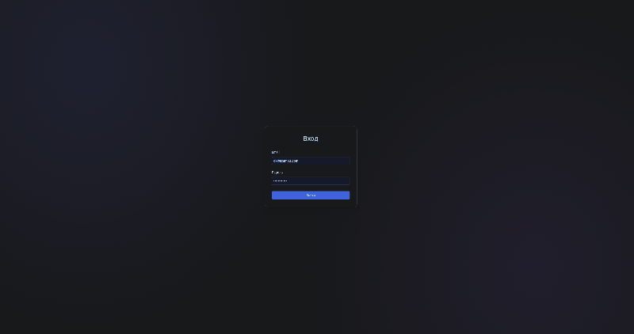

# Home CCTV Web Viewer

Веб-интерфейс для домашнего видеорегистратора (NVR): живое видео с камер по WebRTC, журнал событий, архив с таймлайном и закладками, вход с двухфакторной аутентификацией.

**Полно-функциональное демо:** https://rdnxla.github.io/home-cctv-web-viewer/

**Превью**


Бэкенд демо-версии полностью имитируется в браузере через MSW. Войти можно под `ok@example.com` с паролем `Password123!`. Для входа с 2FA подойдёт `olga@example.com`, код — `123456`.

## О проекте

У меня появилось свободное время, и я решил системно изучить React, опираясь на накопленный опыт разработки и сравнивая подходы с Vue.js. Вместо абстрактных туториалов я взял реальную задачу: веб-интерфейс для управления домашними камерами видеонаблюдения для семьи. Бесплатные китайские облачные решения работают крайне нестабильно. Поэтому задача оказалась одновременно полезной и хорошим поводом прокачать компетенции и освоить новые инструменты.

## Стек

| Область | Технологии |
| --- | --- |
| Основа | React 19, React Router (data router, lazy routes), TypeScript, Vite |
| Данные | TanStack Query, Valibot |
| UI | Radix Themes, Radix Primitives, Radix Icons, SCSS Modules (BEM) |
| Моки | MSW |
| Качество | Biome |
| Инфраструктура | Yarn, GitHub Actions, GitHub Pages |

## Как строилась работа

- **Инфраструктура и архитектура.** Структуру проекта построил по FSD и задал правила направления импортов и публичные API модулей. Подобрал библиотеки, настроил TypeScript и Biome со всеми правилами на уровне error. Разобрался в устройстве React и в подходе к построению компонентов. В качестве дизайн-системы выбрал [Radix Themes](https://www.radix-ui.com/themes), чтобы не тратить время на собственный UI-кит и сосредоточиться на логике.
Гит флоу намеренно нет, так как это личный домашний проект и это бы только тормозило разработку. В дальнейшем, при наличии сервера, понадобится организация релизов. На данном этапе не приоритетно.

- **Работа с AI-агентом.** Сначала намеренно попробовал работать с агентом без правил и инструкций, чтобы оценить результат, и получил хаос. Это стало отправной точкой для изучения работы с агентами: как задавать агенту контекст и ограничивать его возможности, как формулировать задачи, как всё это влияет на расход токенов. В итоге в [CLAUDE.md](CLAUDE.md) описаны архитектурные правила, соглашения по коду и границы доступа. В [.claude/agents/](.claude/agents/) лежат агенты с разделёнными ролями: `architect` проектирует решение, `developer` реализует согласованный план, `tester` пишет тесты.

- **Разделение труда.** Сам я сосредоточился на сложных механиках React. Вёрстку и реалистичные мок-обработчики (сценарии ошибок, задержки, генерация данных, имитация видеопотока) я поручил агенту.

## Что дальше

Сейчас изучаю серверную разработку, чтобы заменить моки настоящим сервером. Сервер планирует работать на мини-ПК с публичным IP в защищённом контуре и обращаться к API регистратора внутри локальной сети. Соответственно от апи регистратора, зависит широта функционала приложения.

## Возможности

- **Дашборд:** сетка камер со статусами, сводка по регистратору и последние события.
- **Страница камеры:** имитация живого видео по WHEP (WebRTC over HTTP), панель управления, переключение на другие камеры.
- **Журнал событий:** фильтры по категории, типу и периоду, поиск, сортировка и пагинация.
- **Архив:** выбор камеры и дня, таймлайн записей и событий, воспроизведение со скоростью от 0.5× до 16×, закладки.
- **Вход:** пароль, опциональный одноразовый код (2FA) и обработка ошибок, включая блокировку после неверных попыток, rate limit, 5xx и таймауты.
- **Оформление:** светлая и тёмная темы, выбор акцентного цвета.


## Запуск

Node.js 22+, Corepack .

```bash
corepack enable
yarn install
yarn msw init public --no-save
```

Dev-сервер работает по HTTPS и ожидает сертификаты в `certs/`. Нужно создать через [mkcert](https://github.com/FiloSottile/mkcert):

```bash
mkdir -p certs
mkcert -key-file certs/localhost-key.pem -cert-file certs/localhost.pem localhost
yarn dev
```

## Тестовые сценарии в моках

У всех аккаунтов из `src/mocks/data/accounts.json` пароль `Password123!`. Специальные адреса включают ошибочные сценарии:

| Email | Поведение |
| --- | --- |
| `olga@example.com`, `petr.client@example.com` | требуется код 2FA `123456` |
| `error500@example.com` | 500 |
| `maintenance@example.com` | 503 |
| `ratelimited@example.com` | 429 |
| `timeout@example.com` | сервер не отвечает |

Ещё несколько сценариев:

- После трёх неверных паролей email блокируется на 60 секунд.
- Камера `cam-3` отвечает ошибкой 504 через 3 секунды, а `cam-4` ни разу не выходила на связь.
- Поиск `error500` в журнале событий возвращает 500.