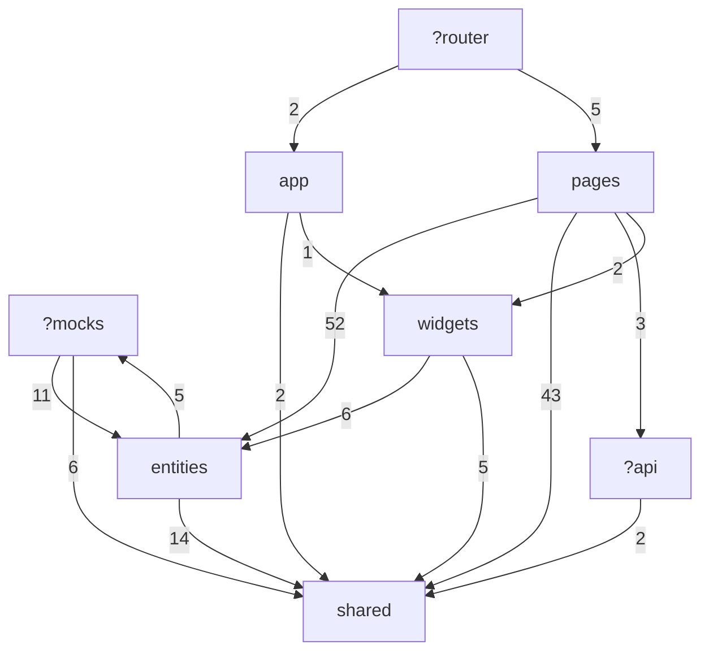
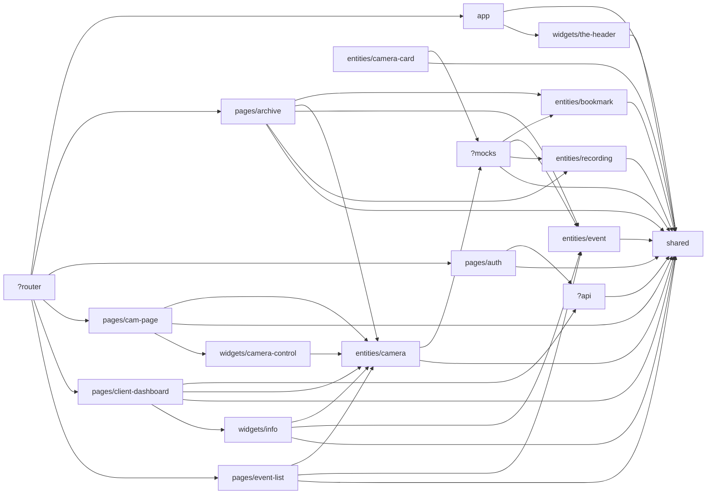

# Auto-scanning imports (generated by fsd-imports.mjs)

Files scanned: 137. Aliases: `@/`→`src`

## Slices

| id | files | segments | Public API (index) | fan-in | fan-out |
|---|---|---|---|---|---|
| app | 2 | layouts | n/a | 1 | 2 |
| pages/archive | 22 | lib, model, ui | yes | 1 | 5 |
| pages/auth | 2 | model | **NO** | 1 | 2 |
| pages/cam-page | 4 | ui | yes | 1 | 3 |
| pages/client-dashboard | 5 | model, ui | yes | 1 | 4 |
| pages/event-list | 8 | model, ui | yes | 1 | 3 |
| widgets/camera-control | 2 | ui | yes | 1 | 1 |
| widgets/info | 4 | ui | yes | 1 | 3 |
| widgets/the-header | 1 | - | **NO** | 1 | 1 |
| entities/bookmark | 5 | api, model | yes | 2 | 1 |
| entities/camera | 14 | api, lib, model, ui | yes | 6 | 2 |
| entities/camera-card | 1 | - | **NO** | 0 | 2 |
| entities/event | 9 | api, lib, model, ui | yes | 4 | 1 |
| entities/recording | 7 | api, model, ui | yes | 2 | 1 |
| entities/user-profile-card | 1 | - | **NO** | 0 | 0 |
| shared | 26 | api, components, config, lib, ui, utils | n/a | 15 | 0 |
| ?api | 4 | auth, user | n/a | 2 | 1 |
| ?mocks | 15 | data, handlers | n/a | 2 | 4 |
| ?router | 1 | - | n/a | 0 | 6 |

## Violations

- layer-upward: 26
- non-public-api: 2

### layer-upward

| from (file) | to | import |
|---|---|---|
| src/api/auth/auth.ts | shared/api/http | `@/shared/api/http` |
| src/api/user/user.ts | shared/api/http | `@/shared/api/http` |
| src/mocks/data/bookmarks.ts | entities/bookmark | `@/entities/bookmark` |
| src/mocks/data/bookmarks.ts | entities/event | `@/entities/event` |
| src/mocks/data/events.ts | entities/event | `@/entities/event` |
| src/mocks/data/events.ts | entities/event | `@/entities/event` |
| src/mocks/data/recordings.ts | entities/event | `@/entities/event` |
| src/mocks/data/recordings.ts | entities/recording | `@/entities/recording` |
| src/mocks/handlers/archive.ts | entities/bookmark | `@/entities/bookmark` |
| src/mocks/handlers/archive.ts | entities/bookmark | `@/entities/bookmark` |
| src/mocks/handlers/archive.ts | entities/recording | `@/entities/recording` |
| src/mocks/handlers/archive.ts | shared/api/authErrorCodes | `@/shared/api/authErrorCodes` |
| src/mocks/handlers/archive.ts | shared/api/authErrorCodes | `@/shared/api/authErrorCodes` |
| src/mocks/handlers/auth.js | shared/utils/auth | `../../shared/utils/auth` |
| src/mocks/handlers/events.ts | entities/event | `@/entities/event` |
| src/mocks/handlers/events.ts | entities/event | `@/entities/event` |
| src/mocks/handlers/events.ts | shared/api/authErrorCodes | `@/shared/api/authErrorCodes` |
| src/mocks/handlers/events.ts | shared/api/pagination | `@/shared/api/pagination` |
| src/mocks/handlers/events.ts | shared/lib/isOneOf | `@/shared/lib/isOneOf` |
| src/router/routes.ts | app/layouts/empty/EmptyLayout | `@/app/layouts/empty/EmptyLayout` |
| src/router/routes.ts | app/layouts/main/MainLayout | `@/app/layouts/main/MainLayout` |
| src/router/routes.ts | pages/auth/Auth | `@/pages/auth/Auth` |
| src/router/routes.ts | pages/client-dashboard | `@/pages/client-dashboard` |
| src/router/routes.ts | pages/cam-page | `@/pages/cam-page` |
| src/router/routes.ts | pages/event-list | `@/pages/event-list` |
| src/router/routes.ts | pages/archive | `@/pages/archive` |

### non-public-api

| from (file) | to | import |
|---|---|---|
| src/app/layouts/main/MainLayout.tsx | widgets/the-header/TheHeader | `@/widgets/the-header/TheHeader` |
| src/router/routes.ts | pages/auth/Auth | `@/pages/auth/Auth` |

## Layer graph (import count)

## Slice graph

