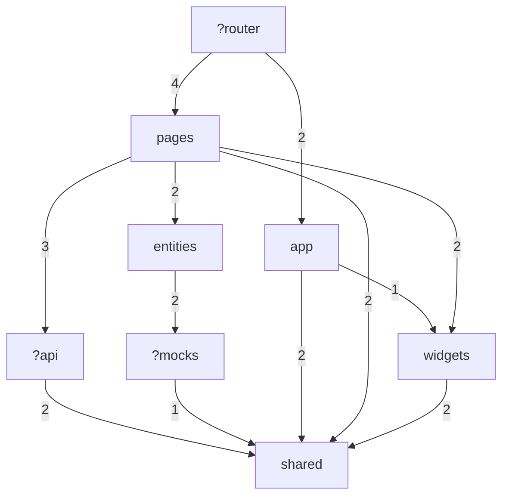
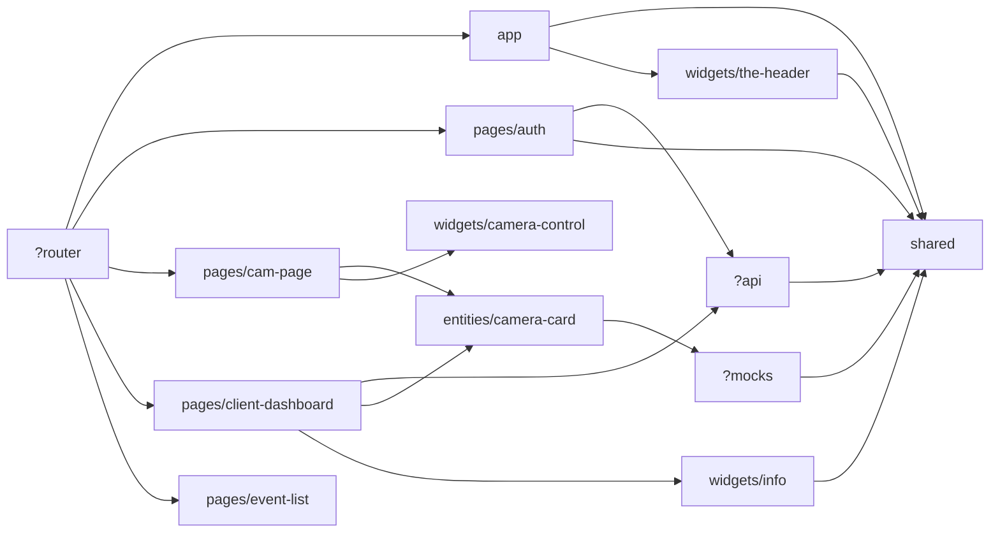

# Auto-scanning imports (generated by fsd-imports.mjs)

Files scanned: 38. Aliases: `@/`→`src`

## Slices

| id | files | segments | Public API (index) | fan-in | fan-out |
|---|---|---|---|---|---|
| app | 2 | layouts | n/a | 1 | 2 |
| pages/auth | 2 | model | **NO** | 1 | 2 |
| pages/cam-page | 1 | - | **NO** | 1 | 2 |
| pages/client-dashboard | 2 | model | **NO** | 1 | 3 |
| pages/event-list | 1 | - | **NO** | 1 | 0 |
| widgets/camera-control | 1 | - | **NO** | 1 | 0 |
| widgets/info | 1 | - | **NO** | 1 | 1 |
| widgets/the-header | 1 | - | **NO** | 1 | 1 |
| entities/camera-card | 1 | - | **NO** | 2 | 1 |
| entities/user-profile-card | 1 | - | **NO** | 0 | 0 |
| shared | 6 | api, components, utils | n/a | 6 | 0 |
| ?api | 4 | auth, user | n/a | 2 | 1 |
| ?mocks | 10 | data, handlers | n/a | 1 | 1 |
| ?router | 1 | - | n/a | 0 | 5 |

## Violations

- layer-upward: 9
- non-public-api: 9

### layer-upward

| from (file) | to | import |
|---|---|---|
| src/api/auth/auth.ts | shared/api/http | `@/shared/api/http` |
| src/api/user/user.ts | shared/api/http | `@/shared/api/http` |
| src/mocks/handlers/auth.js | shared/utils/auth | `../../shared/utils/auth` |
| src/router/routes.ts | app/layouts/empty/EmptyLayout | `@/app/layouts/empty/EmptyLayout` |
| src/router/routes.ts | app/layouts/main/MainLayout | `@/app/layouts/main/MainLayout` |
| src/router/routes.ts | pages/auth/Auth | `@/pages/auth/Auth` |
| src/router/routes.ts | pages/client-dashboard/ClientDashboard | `@/pages/client-dashboard/ClientDashboard` |
| src/router/routes.ts | pages/cam-page/CamPage | `@/pages/cam-page/CamPage` |
| src/router/routes.ts | pages/event-list/EventList | `@/pages/event-list/EventList` |

### non-public-api

| from (file) | to | import |
|---|---|---|
| src/app/layouts/main/MainLayout.tsx | widgets/the-header/TheHeader | `@/widgets/the-header/TheHeader` |
| src/pages/cam-page/CamPage.tsx | widgets/camera-control/CameraControls | `@/widgets/camera-control/CameraControls` |
| src/pages/cam-page/CamPage.tsx | entities/camera-card/CameraCard | `@/entities/camera-card/CameraCard` |
| src/pages/client-dashboard/ClientDashboard.tsx | widgets/info/InfoBlock | `@/widgets/info/InfoBlock` |
| src/pages/client-dashboard/ClientDashboard.tsx | entities/camera-card/CameraCard | `@/entities/camera-card/CameraCard` |
| src/router/routes.ts | pages/auth/Auth | `@/pages/auth/Auth` |
| src/router/routes.ts | pages/client-dashboard/ClientDashboard | `@/pages/client-dashboard/ClientDashboard` |
| src/router/routes.ts | pages/cam-page/CamPage | `@/pages/cam-page/CamPage` |
| src/router/routes.ts | pages/event-list/EventList | `@/pages/event-list/EventList` |

## Layer graph (import count)

## Slice graph

